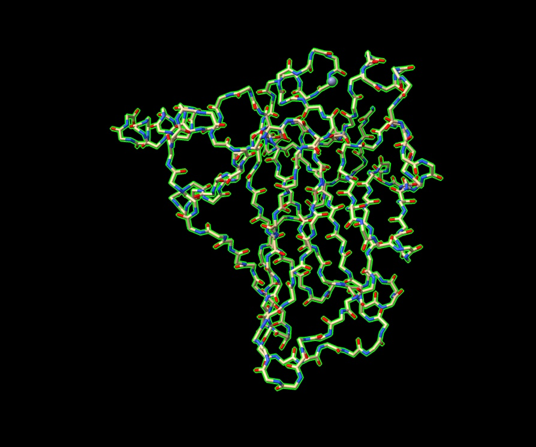
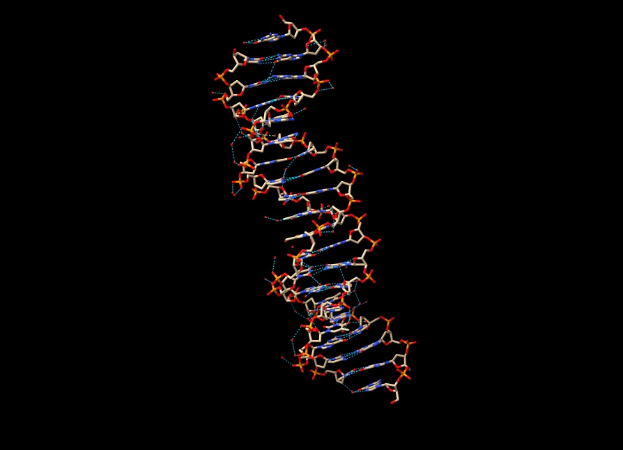
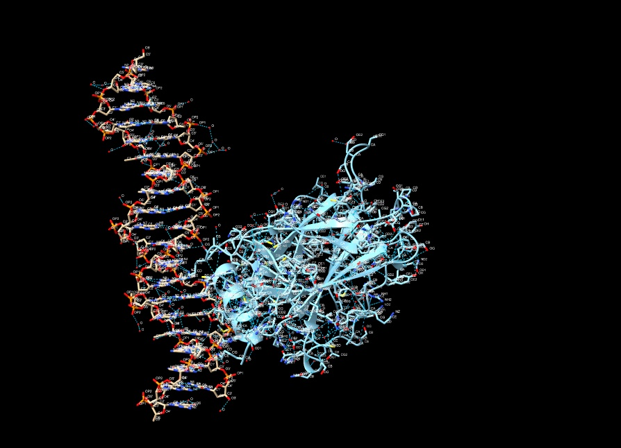

# Scientist’s Mission (0153B050, 龔筱惠)

**GitHub Repository:** [https://github.com/eunchnox/0153B050](https://github.com/eunchnox/0153B050)

## Who Stole TP53’s Superpower? Searching for the Key to Unlock Cancer
### Using AI to Uncover the Secrets of TP53–DNA Interactions

---

### 1. 【The LEGO Assembly Line】
**Question:** What type of bond links amino acids together to form a protein? Which amino acids form hydrogen bonds with each other?

**Answer:**

#### The Bond Linking Amino Acids
Amino acids are linked together by **peptide bonds** (also called amide bonds) to form the backbone of a protein:
* **How they form:** Through a condensation reaction where the carboxyl group ($-\text{COOH}$) of one amino acid reacts with the amino group ($-\text{NH}_2$) of the next, releasing a molecule of water.
* **The Structure:** This creates a strong covalent bond ($\text{C}-\text{N}$) that connects the amino acids in a long, repeating chain.
* **Directionality:** Because of how these bonds form, every protein chain has a distinct beginning and end: an **N-terminus** (the free amino end) and a **C-terminus** (the free carboxyl end).

#### Hydrogen Bonds in p53 (3KMD)
* **Which amino acids form them?** Polar and charged amino acids—most notably **Arginine**, **Lysine**, **Serine**, and **Asparagine**.
* **What do they do in p53?**
  * **Protein Folding:** Internal hydrogen bonds help hold the p53 protein in its correct 3D shape.
  * **DNA Binding:** They act like molecular glue, forming hydrogen bonds with DNA bases so p53 can lock onto its target genes and regulate them.

---

### 2. 【The Double-Track Highway of Life’s Blueprint】
**Question:** How do nucleotides assemble to form double-stranded DNA? What are the basic structural components of DNA? Is DNA right-handed or left-handed? List the names of the four DNA bases. Which bases form hydrogen bonds with each other?

**Answer:**

#### 1. Basic Structural Components of DNA
Each individual building block of DNA—called a **nucleotide**—consists of three parts:
* **A 5-Carbon Sugar:** Specifically called **deoxyribose**.
* **A Phosphate Group:** Attached to the sugar, making up the "backbone" framework.
* **A Nitrogenous Base:** The variable part that carries genetic information (Adenine, Thymine, Cytosine, or Guanine).

#### 2. How Nucleotides Assemble to Form Double-Stranded DNA
* **Building a Single Strand:** Nucleotides link together through **phosphodiester bonds**. The phosphate group of one nucleotide connects to the 3'-carbon of the next sugar, forming a strong sugar-phosphate backbone with a distinct direction (from a **5' end** to a **3' end**).
* **Forming the Double Strand:** Two single strands align next to each other in **antiparallel** directions (one runs 5' to 3', and the other runs 3' to 5'). They bind together through hydrogen bonding between their bases and twist into the classic double-helix shape.

#### 3. Handedness of DNA
* **Right-handed:** The standard, biologically active form of DNA (known as **B-form DNA**) twists in a **right-handed** helix. (While left-handed Z-DNA exists under specific cellular conditions, B-DNA is the predominant form).

#### 4. The Four DNA Bases
The four nitrogenous bases found in DNA are:
* Adenine (A)
* Thymine (T)
* Cytosine (C)
* Guanine (G)

#### 5. Hydrogen Bonding Between Bases
The bases pair up across the two strands through specific hydrogen bonding:
* **Adenine (A)** always pairs with **Thymine (T)**, connected by **2 hydrogen bonds**.
* **Cytosine (C)** always pairs with **Guanine (G)**, connected by **3 hydrogen bonds**.

---

### 3. 【Searching for My One-and-Only Soulmate in the Universe: A 20-Base-Pair Love Code Hidden Among 3 Billion DNA Base Pairs】
**Question:** The source of molecular stability and specificity: hydrogen bonding — How do TP53 and DNA recognize each other?
Using the structure 3KMD, identify one pair of an amino acid and a DNA base that interact with each other.

**Answer:**
In the crystal structure of the p53-DNA complex (PDB: 3KMD), specificity and molecular recognition are achieved through precise hydrogen bonds between the protein's amino acid side chains and the edges of the DNA bases exposed in the grooves.

#### Primary Example: Lysine 120 (Lys120) and Guanine (G)
* **The Amino Acid:** **Lysine 120** is located on loop L1 of the p53 DNA-binding domain. Its long, flexible side chain projects into the DNA groove.
* **The DNA Base:** **Guanine** base within the consensus target sequence.
* **How They Interact:** The amino group ($-\text{NH}_3^+$) on the Lys120 side chain forms direct **hydrogen bonds** with specific acceptor atoms (such as the **O6** and **N7** atoms) on the edge of the Guanine base in the major groove.

#### Other Key Interacting Pairs in 3KMD
* **Arginine 280 (Arg280) & Guanine (G):** The guanidino group of Arg280 forms stable hydrogen bonds with Guanine bases, acting as a crucial anchor for sequence-specific major groove recognition.
* **Arginine 273 (Arg273):** Frequently forms critical hydrogen bonds with the DNA backbone or bases, helping position the p53 core domain securely onto its target gene sequence.

---

### 4. 【Return to the Crime Scene】
**Question:** Why can a mutation (change) in just one amino acid of a protein sometimes lead to a serious human disease? Give one specific example of such a disease.

**Answer:**
A single amino acid change can cause severe disease because a protein's 3D shape and function rely on its exact sequence. Swapping even one amino acid can disrupt critical hydrogen bonds, prevent proper folding, or ruin an active site where the protein binds its target.

#### Specific Example: Sickle Cell Disease
* **The Mutation:** A single swap at position 6 in the hemoglobin protein replaces **Glutamic acid** (hydrophilic) with **Valine** (hydrophobic).
* **The Consequence:** This creates a sticky hydrophobic patch, causing hemoglobin proteins to clump into rigid, rod-like fibers when oxygen is low.
* **The Disease:** Red blood cells deform into rigid "sickle" shapes, blocking blood vessels and causing severe pain, organ damage, and chronic anemia.

---

### 5. 【Return to the Crime Scene: Searching for Clues】
**Question:** Using the TP53–DNA structure (3KMD), identify one TP53 amino acid mutation that can lead to uncontrolled cell division and contribute to the development of cancer.
Then examine this amino acid in ChimeraX. Based on its three-dimensional position, determine whether the mutated amino acid is located directly at the protein–DNA interface or somewhere else in the protein.

**Answer:**

> **Note:** Save your ChimeraX session file as `0153B050.cxs`.